# Scissor lift: a CANopen example

A mobile elevating work platform with four devices on one CAN bus. Each device is its own OpenPLC
project. It runs on one Linux host without any CAN hardware: four runtime containers share a
virtual CAN bus, and a machine panel in your browser plays the operator, the safety relay, the
hydraulics and the sensors.

**This is a demonstration. It is not a safety system.** The emergency stop goes through a simulated
safety relay that cuts the valve power. The PLCs only read its status, because the machine has no safety PLC.

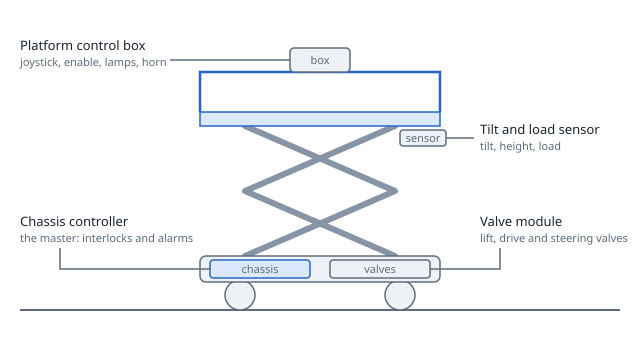

## Devices

| Project | Role | Node | What it shows |
|---|---|---|---|
| `chassis-controller` | CANopen master | 1 | PDOs, SYNC, heartbeat, master watch, startup SDOs, LSS assignment, node control, SDO and EMCY blocks, interlocks |
| `platform-box` | CANopen slave | 10 | LSS "wait for master" with a random serial, event-timed TPDO, packed bit objects, local I/O blocks |
| `valve-module` | CANopen slave | 20 | RPDO receive timeout, parameter object written over SDO, program EMCY on a coil fault, slave status and written-object blocks |
| `tilt-sensor` | CANopen slave | 30 | SYNC-driven TPDO, parameters, a read-only serial and operating time, program EMCY on overload |
| (none) | optional work light | 40 | an optional node the master may find or not (device file only) |

`device-files/` holds the EDS file of each device, exported from its slave page. The master project
imports them, so the master sees the slaves the way a real master would.

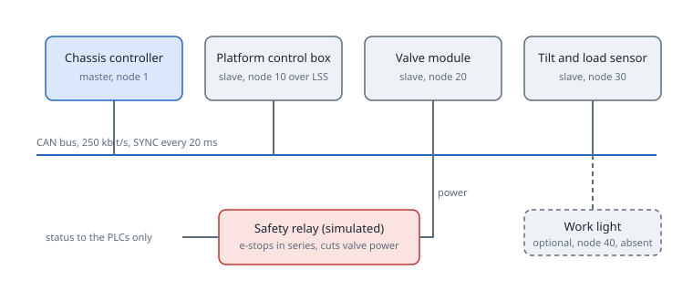

Behaviour you can try:

- The stick and the enable switch drive the lift and the chassis through the valve module.
- A tilt above 3.00 degrees with the platform raised stops the valve module over NMT. It restarts
  below 2.50 degrees with the stick in neutral.
- A load above the limit (450 kg) raises an emergency message and a lamp.
- Either emergency stop opens the safety relay, which cuts the valve power. The valve module sees the
  relay's status contact; the platform box sees its own button contact. Neither decides anything.
- Stop a slave and watch the master hold its inputs, stop its outputs and keep scanning.
- Replace the platform box: the new box has a new random serial and no node ID, and the master
  commissions it again over LSS.

## What you need

- A Linux host: a Raspberry Pi 4 or 5, or a PC (also a Linux virtual machine). Run the commands as root.
- Docker Engine.
- `iproute2`, `util-linux` (`nsenter`), `can-utils` (`cangw`) and `python3`.
- The kernel modules `vxcan`, `can-gw` and `gpio-sim`. Most distribution kernels have them.
- The OpenPLC Editor with CANopen support (this fork) on the same machine or another one: a release
  from `v4.3.4-canopen.3` on, or a build of this branch. Older releases write an older CANopen
  configuration version, which the example's runtime image refuses at upload.

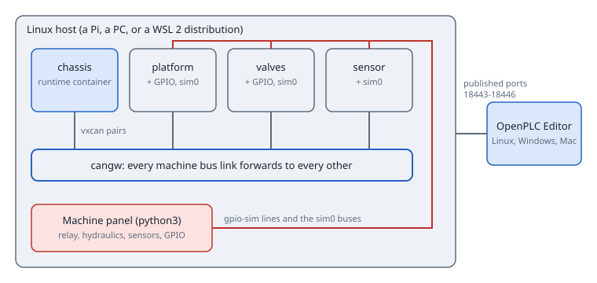

## Run it

```bash
sudo ./run.sh up        # four runtime containers, the bus, the gateway and the GPIO chips
sudo ./run.sh status    # what each runtime reports
sudo ./run.sh panel     # the machine panel at http://127.0.0.1:8080
sudo ./run.sh down      # remove everything the example made
```

The runtimes are at `127.0.0.10` (chassis controller), `127.0.0.11` (platform box), `127.0.0.12`
(valve module) and `127.0.0.13` (tilt sensor), port 8443. They also listen on `127.0.0.1:18443` to
`18446`. When another runtime on the host already uses port 8443, `run.sh up` says so and publishes only
the `18443` to `18446` ports; reach the runtimes from another machine with the helpers below. Each runtime needs a user once; the example uses `lift` with the password `lift-example`
(set `SCISSOR_USER` and `SCISSOR_PASSWORD` to change them). The image is
`ghcr.io/tonihoohoo/openplc-runtime:v4.3.2-canopen.4`; set `SCISSOR_IMAGE` for another.

### Windows: a virtual machine with Multipass

Windows has no CAN gateway or GPIO simulator kernel modules, and the stock WSL 2 kernel lacks `gpio-sim`, so
run the example in a small Ubuntu virtual machine and keep the editor on Windows. This needs Windows Pro,
Enterprise or Education, because Multipass uses Hyper-V.

1. Turn Hyper-V on once, in an administrator PowerShell, and restart:
   `Enable-WindowsOptionalFeature -Online -FeatureName Microsoft-Hyper-V-All`. Virtualization must be on in the BIOS.
2. Install Multipass: `winget install Canonical.Multipass`, then open a new PowerShell.
3. Create the machine and an SSH key for it:

   ```powershell
   multipass launch 24.04 --name lift --cpus 2 --memory 4G --disk 20G
   ssh-keygen -t ed25519 -f $HOME\.ssh\lift -N '""'
   multipass transfer $HOME\.ssh\lift.pub lift:/tmp/lift.pub
   multipass exec lift -- bash -c "cat /tmp/lift.pub >> /home/ubuntu/.ssh/authorized_keys"
   multipass info lift
   ```

   Note the IPv4 address of the machine (`IP` below).
4. In the machine (`multipass shell lift`) install what the example needs and start it:

   ```bash
   curl -fsSL https://get.docker.com | sudo sh
   sudo apt-get install -y can-utils iproute2 util-linux python3 git linux-modules-extra-$(uname -r)
   sudo modprobe -a vxcan can-gw gpio-sim && echo MODULES-OK
   git clone --depth 1 -b canopen https://github.com/tonihoohoo/openplc-editor-canopen.git
   cd openplc-editor-canopen/examples/canopen/scissor-lift
   sudo ./run.sh up
   sudo ./run.sh panel
   ```

   If `MODULES-OK` does not print, run `sudo apt-get install -y linux-generic`, restart the machine and run
   the `modprobe` line again. The panel keeps running in this window.
5. In Windows, in the `examples\canopen\scissor-lift` folder, tell SSH about the key and open the tunnel:

   ```powershell
   Add-Content $HOME\.ssh\config "`nHost IP`n  User ubuntu`n  IdentityFile ~/.ssh/lift"
   ssh ubuntu@IP exit
   powershell -ExecutionPolicy Bypass -File .\connect.ps1 ubuntu@IP
   ```

   Leave that window open. The panel is then at `http://127.0.0.1:8080`.

Then upload the four projects as below. To watch the bus in the machine, run
`sudo candump -tz vxlift-ch vxlift-pb vxlift-vm vxlift-sn`. To remove everything, stop the panel,
run `sudo ./run.sh down` and, on Windows, `multipass delete lift --purge`.

### Open the editor

- **Linux, the editor on the host:** use the addresses above.
- **Mac:** `./mac-connect.sh user@host` adds loopback addresses and one SSH session that forwards them to
  the runtimes' ports `18443` to `18446` and the panel. `./mac-connect.sh --remove` takes them away.
- **Windows, the example on a Linux host or virtual machine:** `.\connect.ps1 user@host` opens one SSH session that
  forwards the four addresses to the runtimes' ports `18443` to `18446` and the panel to
  `http://127.0.0.1:8080`. It uses the OpenSSH client that comes with Windows.

Open the four folders as projects in the editor and upload each to its address. The chassis
controller goes to `127.0.0.10`. Upload the three slaves first, then the master.

An upload does not start the PLC: after uploading each project, start its PLC in the editor (Device, Start PLC). `./run.sh status` shows `plc=RUNNING` for every runtime when they all run.

### Commission the platform box

The platform box starts without a node ID and a random serial number. The chassis controller's platform
node is given its node ID over LSS, but the project does not know the box's serial yet. Open the master's
Online tab and run the LSS search: it lists the box with its serial number. Enter that serial in the LSS
settings of the platform node and upload the chassis controller again; from then on the master gives the
box node 10 at every start. To start at once, the search result's "Use as node 10..." gives it node 10 now and stores its serial number in the project. `./run.sh swap` replaces the box
with a new one, so you can see a spare part being commissioned.

## The machine panel

`./run.sh panel` serves a page with the lift drawing, the stick, the switches, the two emergency
stops with the safety relay reset, a slope and a load slider, a coil-fault switch, the scenario buttons
and a table of what each runtime reports. The panel binds to `127.0.0.1`; use `--bind` only on a
network you trust, because it has no login.

The panel sets the digital inputs through simulated GPIO chips that the `linux_io` blocks read, and
sends the analog values as frames on a per-device simulation bus where a "Terminals (simulation)"
slave turns them into process data. Nothing about the machine logic is in the panel except the
physics: the PLC programs only see inputs.

### Screenshots

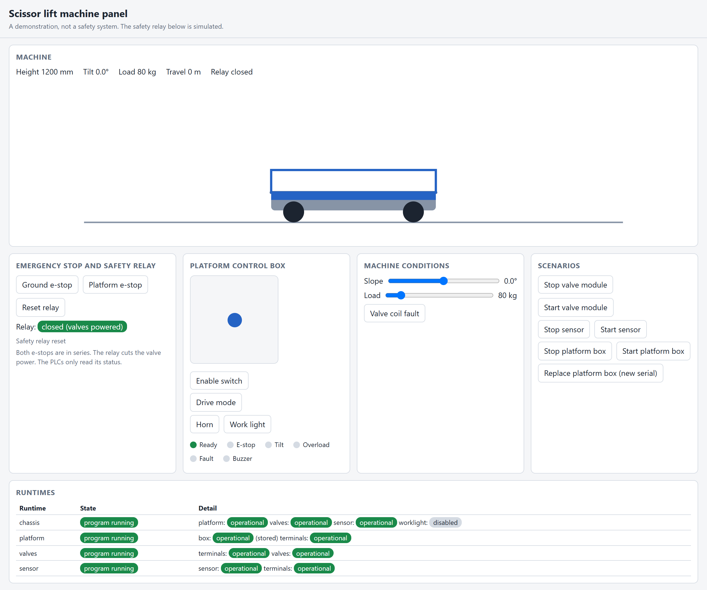

The panel with the platform raised, and with a tilt alarm:

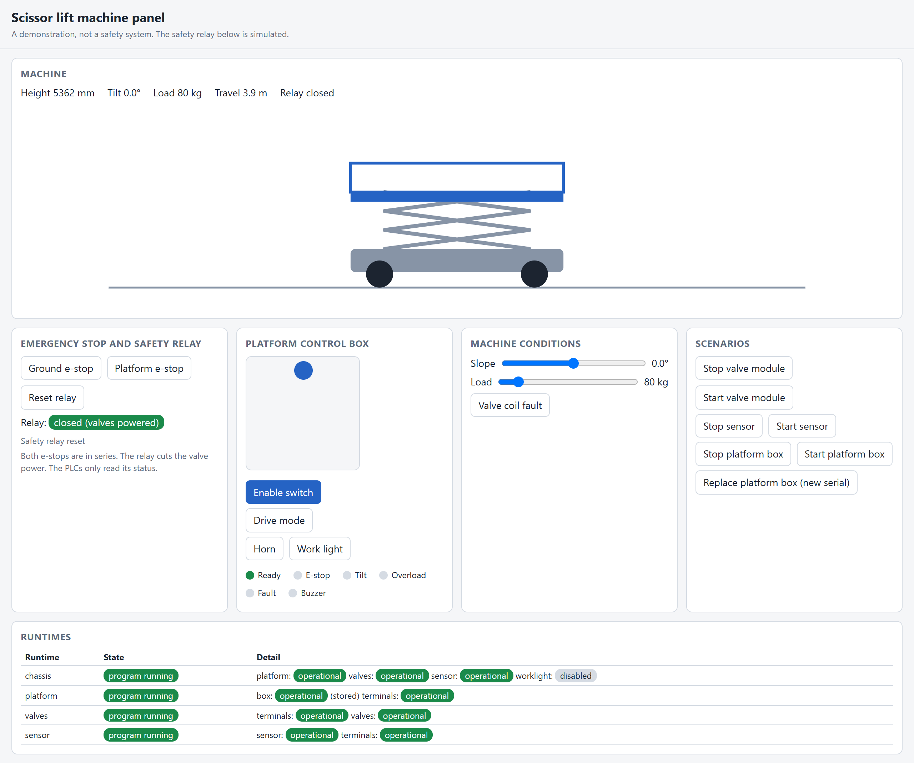

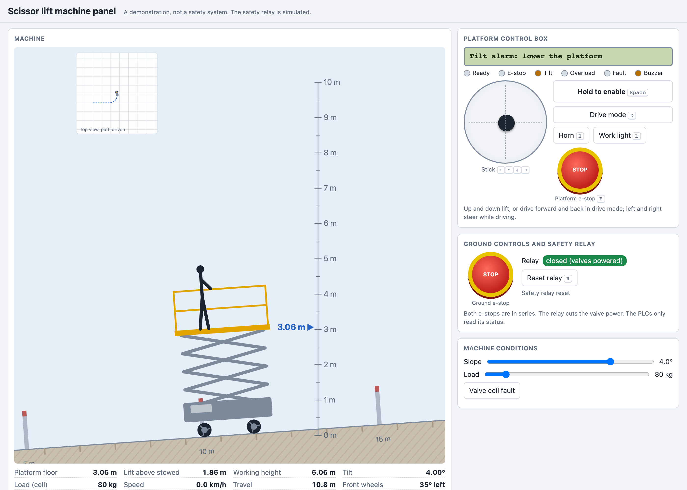

The chassis controller's network in the editor, with the platform node's General tab:

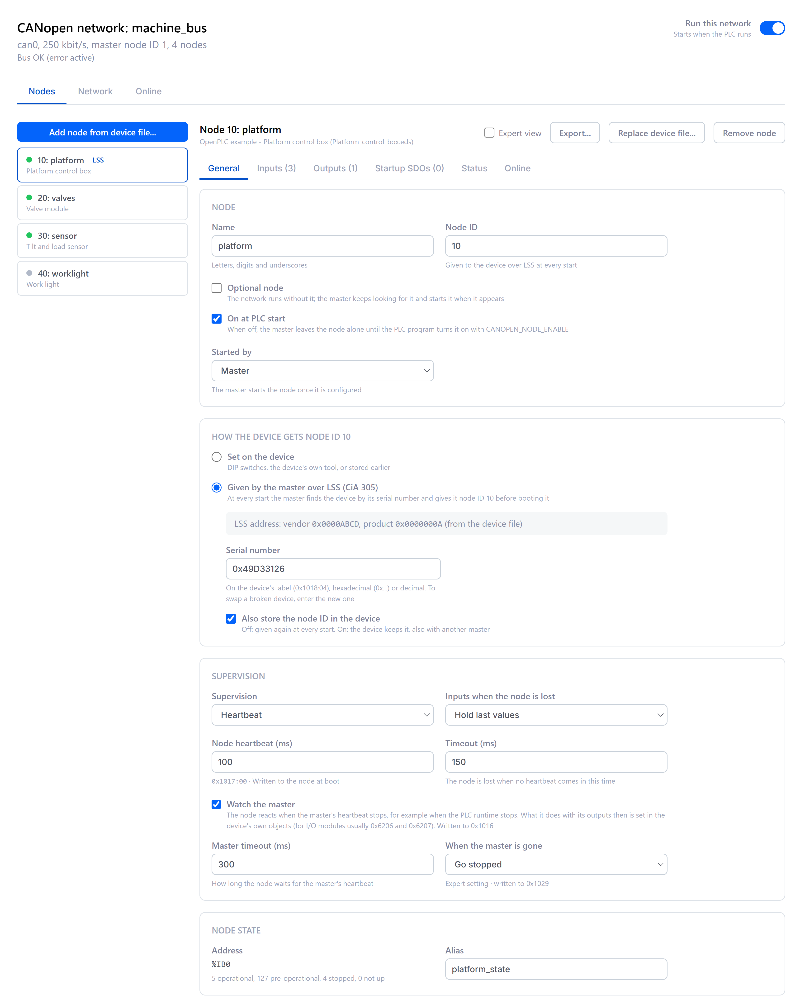

The platform box as a CANopen slave: General, Data, PDOs and Status:

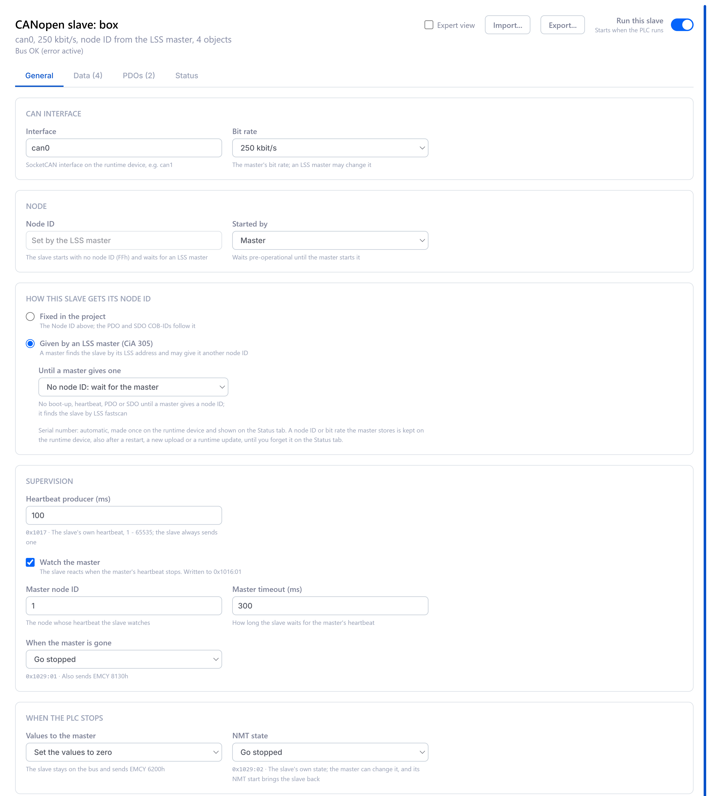

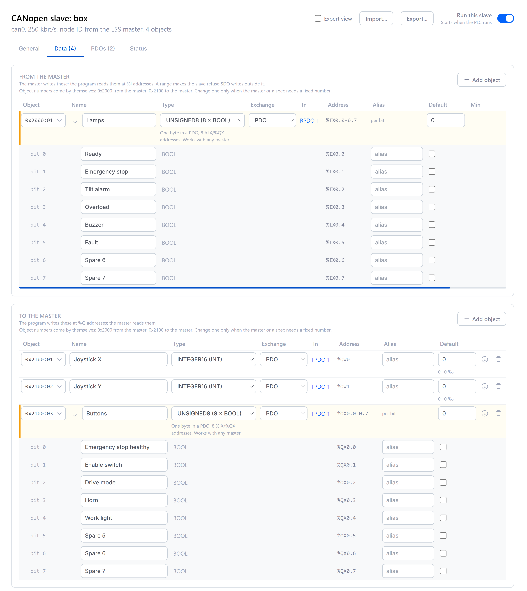

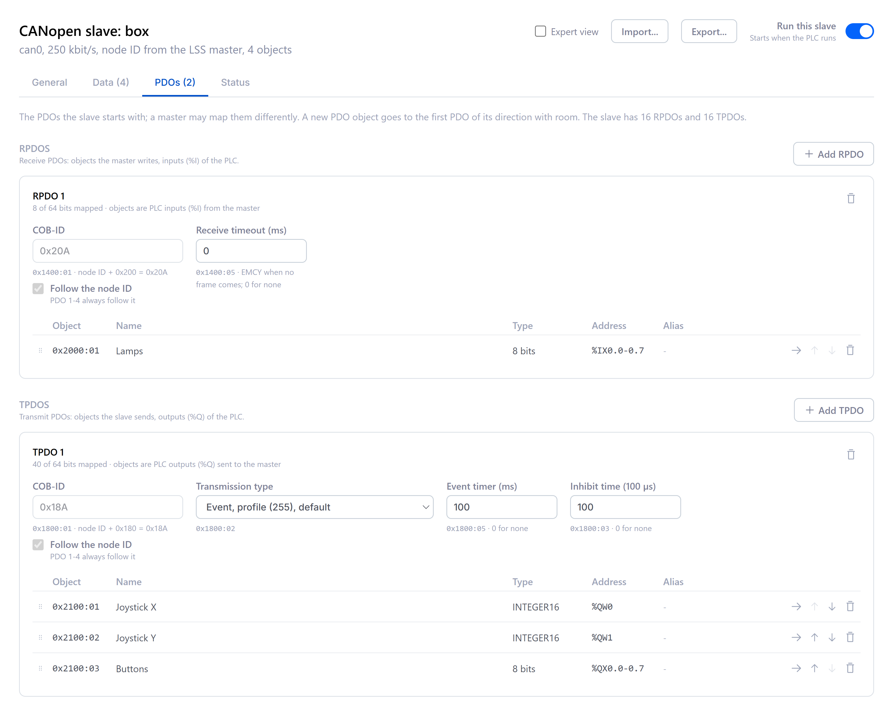

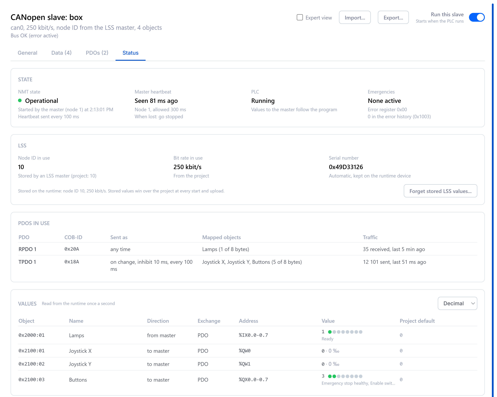

## Checked with

The projects compile and the master configuration validates with the editor's own checks. The example
ran on a Raspberry Pi 5 (64-bit Raspberry Pi OS) with the projects uploaded from the editor on
Windows over an SSH tunnel: lift, lower and drive, both emergency stops and the relay reset, the tilt alarm
with its restart, overload, the coil fault, stopping and starting a device, and replacing the platform box.

## Files

| Path | What it is |
|---|---|
| `chassis-controller/`, `platform-box/`, `valve-module/`, `tilt-sensor/` | the four OpenPLC projects |
| `device-files/` | EDS files exported from the slaves |
| `run.sh` | create, inspect and remove the example |
| `panel/` | the machine panel (Python standard library and one HTML page) |
| `connect.ps1`, `mac-connect.sh` | helpers to reach the runtimes from Windows and Mac |
| `images/` | the drawings above |
